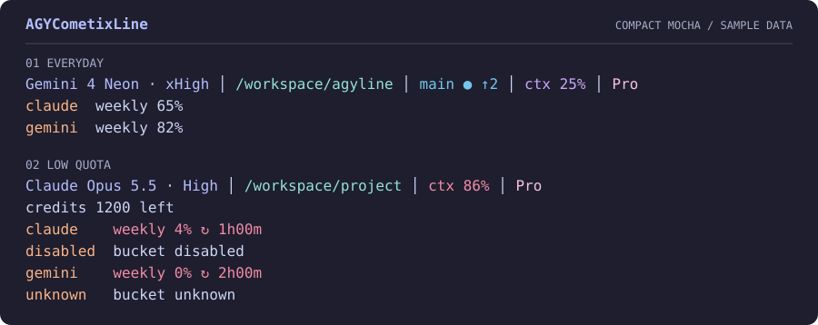

# AGYCometixLine

中文主文档 | [English quick start](README.md)

面向 **Antigravity CLI（AGY）** 的 Rust 状态栏，基于 CCometixLine fork。保留上游的 Rust 渲染器、可组合布局和全屏 TUI，接入 AGY 原生状态栏协议，并提供可恢复的本地安装。



上图取自 `agyline preview` 对内置虚构会话的实际输出，不是用户桌面截图。

**当前版本 0.1.0。** GitHub 仓库名为 **AGYCometixLine**，可执行命令为 **`agyline`**。安装时可直接下载 GitHub Releases 的预编译包，不需要 Rust 工具链。项目未发布 npm 包；`@cometix/ccline` 是上游包，不是本项目。

## 安装预编译版本（推荐）

macOS／Linux：

```sh
curl -fsSL https://raw.githubusercontent.com/CPbianma/AGYCometixLine/main/install.sh | bash
```

Windows PowerShell：

```powershell
irm https://raw.githubusercontent.com/CPbianma/AGYCometixLine/main/install.ps1 | iex
```

安装器会识别当前平台，下载最新 [GitHub Release](https://github.com/CPbianma/AGYCometixLine/releases)，校验 SHA-256，然后执行 `agyline install` 接入 AGY。修改已有设置前会保留备份。如果状态栏没有立即刷新，请重启 AGY。

macOS／Linux 安装指定版本：

```sh
curl -fsSL https://raw.githubusercontent.com/CPbianma/AGYCometixLine/main/install.sh | AGYLINE_VERSION=v0.1.0 bash
```

Windows 可在运行安装器前设置 `$env:AGYLINE_VERSION = "v0.1.0"`。也可以从 Releases 页面手动下载对应压缩包和 `SHA256SUMS`，解压后运行 `agyline install`。

安装后的稳定程序位于 `~/.gemini/antigravity-cli/agyline/agyline`；Windows 使用同目录下的 `agyline.exe`。在完整路径后加 `--config` 可打开配置器。

## 发布新版本

更新 `Cargo.toml` 和更新日志，将修改合并到默认分支后，推送对应的版本标签：

```sh
git tag v0.1.0
git push origin v0.1.0
```

发布工作流会构建 Linux x64、macOS x64／ARM64 和 Windows x64 压缩包，生成 `SHA256SUMS`，并发布到 GitHub Release。手动触发工作流只生成可下载的构建 artifact，不发布 Release。

## 能做什么

- 显示 AGY 实际报告的模型、上下文、订阅、运行状态、后台任务、执行模式，以及目录和 Git 信息；没有数据的条目按其语义隐藏或显示未知。
- 展开 AGY 原生 quota 的动态 bucket，显示剩余比例／数额、重置时间及 `unknown`、`disabled` 状态，不把 bucket 强行解释为固定时间窗口。
- 延续多行布局、左右分组、文字／条形／仪表等渲染方式，以及 4 种皮肤、13 套配色和 Nerd Font／Unicode／ASCII 字形选择。
- 在全屏 TUI 中选择预设、编辑布局和外观、管理模型规则，预览修改并审阅 AGY 设置变更。
- 把本 fork 可执行文件安装到稳定位置，备份设置，并在卸载时仅恢复原来的 `statusLine`。

### 数据边界

1. **额度来自原生 quota bucket。** bucket 的名称、数量和含义由 AGY 输入决定。剩余比例是 remaining fraction，不是已用比例；只有剩余数额时不会凭空推算百分比。缺失不等于 0，禁用不等于耗尽。
2. **费用全部是 `~` 估算，不是账单。** 不应据此核对扣款或认定账户真实余额。
3. **没有可靠字段就不伪造。** 本协议没有可靠的固定 5 小时／7 天窗口、缓存 TTL 或自动压缩阈值，因此不展示伪造的配速、缓存倒计时或距自动压缩数值。
4. 不读取凭据文件、不调用模型、不修改或 patch `agy.exe`。状态栏使用宿主传入的数据；如自行添加 `cmd` 指标，则会执行你明确配置的本地命令。

## 从源码构建（可选）

需要 **Rust 1.89 或更新版本**及对应平台的编译工具链；Git 指标需要 Git。图标建议使用 Nerd Font，没有时可在 TUI 中改用 Unicode 或 ASCII。

在已经获取的本 fork 源码目录中执行：

```sh
cargo build --release --locked
```

Cargo 内部包名暂时仍为 `ccometixline`；对外命令和构建产物是 **`agyline`**，不是 `ccometixline` 或 `ccline`。Windows 产物为 `target/release/agyline.exe`，macOS／Linux 为 `target/release/agyline`。

### Windows PowerShell

先查看内置样例，再选择是否接入宿主：

```powershell
.\target\release\agyline.exe preview --scenario antigravity --width 100 --color none
.\target\release\agyline.exe preview --scenario agy-low-quota --width 100 --color none
.\target\release\agyline.exe preview --scenario agy-startup --width 100 --color none
.\target\release\agyline.exe install
.\target\release\agyline.exe status
```

安装后的稳定可执行文件可直接打开配置器：

```powershell
& "$HOME\.gemini\antigravity-cli\agyline\agyline.exe" --config
```

### macOS／Linux

```sh
./target/release/agyline preview --scenario antigravity --width 100 --color none
./target/release/agyline install
./target/release/agyline status
~/.gemini/antigravity-cli/agyline/agyline --config
```

安装器复制的是当前运行的本 fork 二进制；不会替你下载程序，也不会把 `target/release` 的临时构建路径写入宿主设置。它不自动添加全局 PATH。后文直接使用 `agyline` 的命令，均假设你已自行配置 PATH，否则请使用稳定文件的完整路径。

## 路径与可恢复安装

默认路径：

- AGY 设置：`~/.gemini/antigravity-cli/settings.json`。
- agyline 目录：`~/.gemini/antigravity-cli/agyline/`。
- 稳定程序：Windows 为上述目录的 `agyline.exe`，macOS／Linux 为 `agyline`。
- 工具配置：agyline 目录下的 `config.toml`、`models.toml`、`presets/` 和 `state/`。
- 恢复记录：agyline 目录下的 `installation.json`。

`AGYLINE_HOME` 覆盖 **agyline 目录**；`AGY_CONFIG_DIR` 单独覆盖 **AGY 宿主目录**，设置文件为其下的 `settings.json`。两者独立，改变 `AGY_CONFIG_DIR` 不会自动搬迁 agyline。

`install`、`status`、`uninstall` 都支持 `--settings <path>` 和 `--home <path>`。例如以下 PowerShell 命令使用当前目录下的隔离路径，而不是默认宿主设置：

```powershell
.\target\release\agyline.exe install --settings .\agy-sandbox\settings.json --home .\agy-sandbox\agyline
.\target\release\agyline.exe status --settings .\agy-sandbox\settings.json --home .\agy-sandbox\agyline
.\target\release\agyline.exe uninstall --settings .\agy-sandbox\settings.json --home .\agy-sandbox\agyline
```

请在三个命令中使用同一组路径。自定义 `--home` 不会自动改变之后独立启动进程的环境；日常运行 TUI 时也应设置对应的 `AGYLINE_HOME`。

### 设置修改范围

安装仅管理顶层 `statusLine`，已支持的宿主字段为：

- `type`：`"command"`。
- `command`：安装器生成的稳定程序启动命令。Windows 无空格路径直接调用；含空格路径通过系统 PowerShell 的编码桥接调用，保持 UTF-8 输入输出，不从 PATH 查找启动器。
- `padding`：**竖向留白**，不是水平缩进。
- `enabled`：是否启用。
- `stack_with_default`：是否与默认状态栏叠加。

不生成 Claude Code 的 `subagentStatusLine`、`refreshInterval` 或配套 mod 设置。安装时保留已有 `statusLine` 的未知键以及所有无关设置。

### 备份、冲突与卸载

- 修改已有设置文件前，保留同目录的 `settings.json.agyline-bak-*` 备份；原先没有设置文件时无需备份旧文件。备份可能包含宿主的其他设置，请勿随意上传。
- `installation.json` 记录安装前的 `statusLine`、本工具写入的值和对应路径，不拿整份旧设置覆盖当前设置。
- 卸载仅恢复最初的 `statusLine`；原先没有此键时移除此键。安装后新增的其他宿主设置继续保留。
- 如果受管理的 `statusLine` 已被外部修改，或设置在审阅后发生变化，工具拒绝覆盖。先运行 `status`，人工核对当前值、恢复记录与备份，不要通过删除记录来强行绕过冲突保护。
- AGY 保存配置时省略 `type: "command"`、`enabled: true`、`padding: 0` 或 `stack_with_default: false`，不算外部冲突；修改非默认值、启动命令或未知键仍受冲突保护。
- `uninstall` 不删除稳定程序、配置和恢复记录，避免删除正在运行的 Windows 可执行文件，也便于排查。确认恢复完成后，是否另行清理由你决定。

默认路径卸载示例：

```powershell
& "$HOME\.gemini\antigravity-cli\agyline\agyline.exe" uninstall
```

安装与真实启动的本机验证已完成；卸载、恢复和冲突处理使用隔离目录自动测试，未为验收而中断用户现有集成。具体证据边界见下文。

## 八个预设与外观

- `cometix`（默认，A 版日常紧凑）：Catppuccin Mocha。首行显示模型／推理强度、目录、可用的 Git 信息、`ctx` 和订阅。额度按原生 ID 的首段分行（例如 `3p`、`gemini`），百分比均为**剩余**，不画满格条。剩余 ≤20% 时告警、≤5% 时标为严重；仅在告警且有重置数据时显示倒计时。数额、`unknown` 和 `disabled` 不会变成百分比。
- `minimal`：紧凑的一行，隐藏图标，显示模型、上下文和剩余额度。
- `dashboard`：三行仪表盘，Catppuccin Mocha／pill，包含上下文趋势和宿主活动。
- `budget`：两行、额度优先，Tokyo Night，显示原生 bucket 和重置信息，不假设固定周期。
- `session`：两行、Rosé Pine，显示宿主状态、任务、执行模式与原生额度；它替代上游 `cache-aware`，不再声称有缓存 TTL。
- `focus`：两行、宽上下文条、近期趋势和额度仪表。
- `zen`：一行、ASCII、无颜色。
- `powerline`：两行、Tokyo Night powerline 风格与原生额度仪表。

皮肤：`plain`、`bracket`、`pill`、`powerline`。

更新程序不会改写已有的 `config.toml`。想从旧布局切换：打开 `--config` → **Presets** → 选 **Cometix** → Enter → Ctrl+S。想看所有重置时间和进度条则选 **Budget**。Windows Terminal 自动模式支持真彩色，`NO_COLOR` 仍可关闭颜色。

13 套配色：`terminal`、`catppuccin-mocha`、`catppuccin-latte`、`dracula`、`nord`、`tokyo-night`、`rose-pine`、`gruvbox`、`anthropic-clay`、`powerline-dark`、`powerline-light`、`powerline-rose-pine`、`powerline-tokyo-night`。

本文未嵌入上游截图。仓库已有 `assets/` 图片来自上游，只能作为上游设计参考，不能作为本 fork 在 AGY 中的真实运行效果或验证证据。

## TUI 配置器

在交互终端运行 `agyline` 或 `agyline --config`。六个页面为 Home、Presets、Layout、Style、Models、Antigravity；保留上游 TUI 交互风格。

按键以当前页面底部提示和 `?` 帮助为准：

- 标签栏获得焦点时，左右箭头切换页面，向下箭头／Enter 进入页面。
- 页面放弃焦点时，向上箭头／Esc 返回标签栏；页面内部用箭头导航，支持的页面用 Tab／Shift+Tab 切换控件或筛选项。**Tab 不是全局切页快捷键。**
- **Ctrl+S 保存**，Ctrl+Z／Ctrl+Y 撤销／重做，Ctrl+P 打开命令面板。
- `q` 请求退出，有未保存修改时按对话框选择；`?` 查看帮助。
- `[`／`]` 切换预览样例，`-`／`+` 调整预览宽度，`{` 切换色深，`}` 切换字形。

**普通 `s` 不是全局保存键**；Home 页的 `s` 用于 AGY 设置操作。不要沿用“数字 1–6 切页”或“s 直接保存”的旧说明。

### 手动配置示例

TUI 写入 `AGYLINE_HOME/config.toml`（未设置环境变量时使用默认工具目录）。以下只是布局配置示例，不是实时会话输出：

```toml
preset = "cometix"
palette = "terminal"
skin = "plain"
glyphs = "unicode"
separator = " | "

[[line]]
left = ["model", "dir", "git", "context"]

[[line]]
left = ["plan", { metric = "quota", cells = 8 }]
right = ["state", "tasks"]
```

`quota` 默认按原生 bucket 展开；也可以通过指标的 `options.bucket` 选择确切 bucket ID。只有 AGY 实际传入且指标支持的字段才参与渲染。模型登记表位于 `models.toml`，可从 Models 页编辑；不要把模型推断当成宿主未提供的额度或计费数据。

## 样例、自动测试与真实 AGY 验证

这三类证据必须区分：

**样例预览**：下列命令使用内置样例；可重复检查布局、低额度和启动期缺失字段的表现，不读取真实 AGY 会话。

```sh
agyline preview --scenario antigravity --width 100 --color none
agyline preview --scenario agy-low-quota --width 100 --color none
agyline preview --scenario agy-startup --width 100 --color none
agyline preview --list
agyline preview --all
```

**自动测试**：下面是开发检查命令，不是“此机器已全部通过”的声明：

```sh
cargo test --locked --all-targets
cargo fmt --all -- --check
cargo clippy --locked --all-targets -- -D warnings
cargo build --release --locked
python -m unittest discover -s scripts -p test_verification.py -v
```

CI 配置对 Windows／macOS／Linux 运行测试，并执行格式与 Clippy 检查。持续集成结果以对应工作流的实际运行记录为准；下列计数仅记录本次本机验收。

**A 版复验**：Windows 上 255 项 Rust 测试、8 项验证脚本回归和 1 项 TUI 交互测试通过。AGY 1.5.14 的临时会话和已有安装都观察到了额度文本。见 [A 版验收与边界](docs/superpowers/plans/2026-11-21-compact-quota.md)；此前详细版的结果和复验命令见 [11 月 21 日基线](docs/verification/2026-11-21-agyline.md)。

**2026-11-20 本机验收**：Windows 上通过 252 项 Rust 测试、3 项验证脚本回归测试、格式检查、严格 Clippy 与发布构建。真实 Antigravity CLI 1.5.13 在 132 列终端中提供原生数据和 5 个 quota bucket；临时会话配置及持久安装两条链路均检测到剩余额度文本，没有发送模型请求，也未在启动验证期间改写持久设置。安装更新验证了二进制与构建产物一致、无关设置保留；首次修复写入前创建了原字节备份，随后重复安装无需改写设置。

截图助手不可用，**没有完成桌面截图、图标字体和最终重绘效果的视觉验收**。macOS／Linux 已配置 CI，但本轮没有在这些系统运行，也没有推送或触发远程工作流。卸载／恢复／冲突验证来自隔离自动测试，不冒充真实用户设置的卸载实测。详见 [验收记录](docs/verification/2026-11-20-agyline.md)。

可选真实宿主诊断脚本 `scripts/verify_agy_host.py` 需要 Windows 及隔离环境中的 `pywinpty`。它默认用临时 `--settings` 覆盖，只保存白名单处理后的诊断输入及布尔摘要，不记录原始终端横幅；产物放在 Git 忽略的 `local/`，仍不应公开上传。`scripts/verify_local_install.py --apply` 会修改持久集成，只有明确需要更新安装时才使用。

## 分发与发布

- 源码仓库：[CPbianma/AGYCometixLine](https://github.com/CPbianma/AGYCometixLine)。
- [GitHub Releases](https://github.com/CPbianma/AGYCometixLine/releases) 提供 Linux x64、macOS x64／ARM64 和 Windows x64 预编译压缩包，以及覆盖全部压缩包的 `SHA256SUMS`。
- 根目录 `install.sh` 和 `install.ps1` 会下载并校验预编译包，再调用现有的可恢复安装流程；无需安装 Rust。
- `.github/workflows/release.yml` 支持手动构建 artifact，并在推送 `v*` 标签时自动创建对应的 GitHub Release。发布任务仅获得 `contents: write` 权限，构建任务仍为只读权限。
- 当前没有发布 npm 包；`@cometix/ccline` 属于上游项目。

## 上游与许可状态

上游项目：[Haleclipse/CCometixLine](https://github.com/Haleclipse/CCometixLine)。本 fork 的基线固定为提交 [`1749ff85b52d8d10e67e0a04d247ceab768f380f`](https://github.com/Haleclipse/CCometixLine/tree/1749ff85b52d8d10e67e0a04d247ceab768f380f)。保留并感谢其 Rust 实现、渲染器、TUI、预设和外观设计。

上游 README 与 Cargo 元数据声明 MIT，但固定基线的源码树未附独立 `LICENSE` 文件。本仓库如实记录这一缺口，不伪造许可证正文、版权年份或 fork 作者身份，也不把本声明当作完整授权证明。来源、保留资源及对外再分发前需核实的事项见 [THIRD_PARTY_NOTICES.md](THIRD_PARTY_NOTICES.md)。
